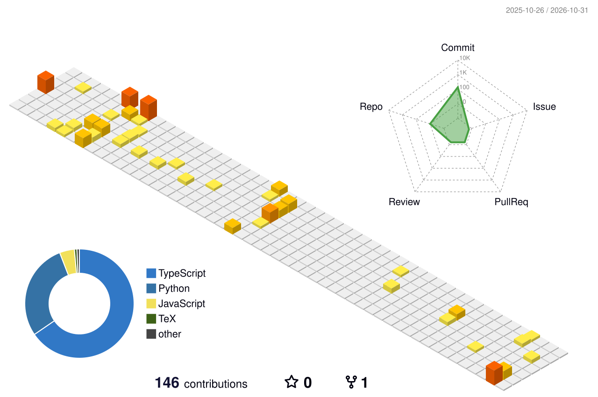

### Hi, I'm Divyam 👋

IT undergraduate at FCRIT building full-stack products and doing applied AI/ML research. I like problems where models meet real deployments: how they fail, whether they are fair, and how to keep data private.

🌐 [Portfolio](https://portfolio-dn-mocha.vercel.app) · 💼 [LinkedIn](https://www.linkedin.com/in/divyam-navin/)

## Featured work

| Project | What it is |
| --- | --- |
| [failing-silently](https://github.com/Divyam1909/failing-silently) | Research: can label-free telemetry tell harmful LLM deployment changes from benign ones? 110k+ graded calls across 3 open LLMs |
| [Aequitas-Prime](https://github.com/Divyam1909/Aequitas-Prime) | Fairness-as-a-Service: detect, explain and mitigate bias in ML datasets and models (FastAPI, Streamlit, SHAP) |
| [synapse6-sih](https://github.com/Divyam1909/synapse6-sih) | DigiVastu: land-record digitisation and validation system, Smart India Hackathon 2026 |
| [encryption-v2](https://github.com/Divyam1909/encryption-v2) | Fully homomorphic encryption (CKKS) for privacy-preserving ML on encrypted sensor data, IIT Dharwad |
| [EduSage](https://github.com/Divyam1909/EduSage) | AI-powered education platform (React, Node.js, MongoDB) |
| [portfolio-dn](https://github.com/Divyam1909/portfolio-dn) | Interactive Three.js portfolio |

## Experience

Internships at **ZetaQ** (LLM pipelines), **Thinking Engines** (player-performance analytics), **Arms Robotics** (embedded dashboards), **VanillaKart** (SEO and growth) and **Finnfluent Education** (finance education content).

## Tech

**Languages:** Python, JavaScript, TypeScript, C, SQL
**Web:** React, Next.js, Node.js, Express, FastAPI, Three.js
**AI/ML:** PyTorch, Hugging Face, LoRA/QLoRA fine-tuning, RAG, Ollama, llama.cpp, Gemini API
**Data:** PostgreSQL (Supabase), MongoDB, MySQL

## Contributions

<picture>
  <source media="(prefers-color-scheme: dark)" srcset="profile-3d-contrib/profile-night-rainbow.svg">
  <source media="(prefers-color-scheme: light)" srcset="profile-3d-contrib/profile-green-animate.svg">
  
</picture>
